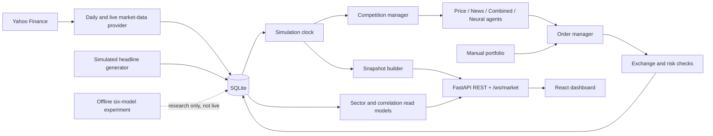

# AI Market Simulator

**Project type:** software engineering / algorithmic trading simulation  
**Status:** research prototype; historical replay and offline evaluation are complete, live deployment of the latest commit is not yet verified.

AI Market Simulator is a paper-trading platform for developing, simulating and comparing multiple algorithmic trading strategies against historical and live market data. Four independent agents manage portfolios in a shared market environment with the same starting capital and trading constraints. A fifth, manual portfolio lets a person place orders through the same execution engine. Every account is marked to market, ranked, and recorded so that decisions can be inspected rather than judged only by a final return number.

The project is an engineering investigation into how trading strategies are evaluated. The central problem is not generating signals; it is preventing a plausible-looking backtest from being mistaken for evidence. It is **not** an investment platform, a brokerage connection or a claim that any strategy has predictive value. All orders are simulated. Historical headlines are generated locally. Market prices come from Yahoo Finance.

The current implementation covers:

- 120 US-listed stocks across 13 industry sectors.
- 8 ETF benchmarks, kept out of the agent competition.
- Five years of daily replay data by default, with selectable replay windows from one week to the full history.
- Three deterministic heuristic strategies: Price AI, News AI and Combined AI.
- A live **Neural AI** agent that ranks the universe with a trained neural network.
- A manual portfolio with long, short, sell and cover orders.
- Active model training from recorded bars and headlines, with status polling and a Models tab.
- A separate offline experiment comparing the three heuristics with Random Forest, Gradient Boosting and a neural-network baseline.
- Walk-forward validation, transaction costs, drawdown, Sharpe ratio, volatility, regime and turnover reporting.
- Sector attribution and return-correlation diagnostics.

The live competition includes both transparent heuristics and Neural AI. The offline experiment remains a separate walk-forward study; the live model is trained from the simulator's own recorded history and only scores bars after its training cutoff.

---

## 1. Objectives

### Primary objectives

1. Build a functional paper-trading environment with a deterministic clock, order lifecycle and portfolio accounting.
2. Implement several independent strategies that receive the same market information and operate under the same constraints.
3. Compare strategies on identical historical periods, transaction costs and execution assumptions.
4. Evaluate results with return, risk, drawdown, turnover and benchmark-relative measures rather than return alone.

### Secondary objectives

- Introduce machine-learning baselines and compare them with simple heuristics.
- Validate models chronologically with walk-forward training and label purging.
- Expose sector-level attribution and cross-sectional correlation so a large universe is not mistaken for many independent opportunities.
- Investigate whether combining price and sentiment signals improves results.

### Future objectives

- Reduce survivorship bias with point-in-time historical constituents and delisted securities.
- Replace simulated headlines with an archived historical news source.
- Export full daily equity curves and extend the evaluation across more market regimes.
- Add more rigorous risk models, portfolio construction and statistical uncertainty estimates.

---

## 2. System architecture

The implementation is a single-process FastAPI backend with a React/Vite frontend. The backend owns the clock, the market data, the agents, the order book and SQLite. The frontend is a read-mostly client; it submits manual orders and control actions through REST and receives complete snapshots over a WebSocket.



### Stack

| Component | Technology |
| --- | --- |
| Backend | Python 3.12 |
| API | FastAPI |
| Database | SQLite with WAL |
| Frontend | React 18 + TypeScript |
| Build | Vite |
| Market data | Yahoo Finance public chart endpoint |
| Communication | REST + full-snapshot WebSocket |
| Hosting blueprint | Render web service + static site |

### How a replay bar moves through the system

1. **Ingestion.** The backend loads aligned daily OHLCV bars from Yahoo Finance, or generates deterministic sample bars when Yahoo is unavailable. Bars are stored in SQLite with a shared session calendar and `bar_index`.
2. **Gating.** `SimulationClock` keeps a cursor. Repository reads for a decision are limited to bars and news at or before that cursor. The agent context loads at most the last 120 bars per stock and a rolling news window.
3. **Decision.** At the current close, the competition manager asks each agent for order intents and forecast calls. The agent sees only the gated context.
4. **Execution.** Intents become pending orders. They fill at the **next bar's open**, not at the close that produced the signal. Fill price, fees and eligible quantities are recorded.
5. **Accounting.** Cash, signed positions, average entry, realized P&L, borrow fees and portfolio snapshots are updated. Equity is `cash + Σ(quantity × last close)` with signed quantities, so shorts reduce equity rather than appearing as assets.
6. **Presentation.** The clock publishes a complete snapshot containing quotes, indices, forecasts, leaderboard, manual portfolio, universe metadata and data-source state.
7. **Transport.** The WebSocket pushes snapshots. If the socket is unavailable, the frontend polls REST every three seconds. Manual orders are queued through the same order manager as agent orders.

### Main code boundaries

| Area | Main files |
| --- | --- |
| Clock, replay/live lifecycle, snapshots | `backend/app/services/simulation_clock.py` |
| Replay date windows | `backend/app/services/replay_ranges.py` |
| Agent orchestration and context | `backend/app/competition/manager.py` |
| Strategies | `backend/app/ai/price_agent.py`, `news_agent.py`, `combined_agent.py` |
| Feature calculations | `backend/app/ai/features.py` |
| Order validation and fills | `backend/app/trading/order_manager.py`, `exchange.py`, `risk_limits.py` |
| SQLite schema and queries | `backend/app/database/database.py`, `repositories.py` |
| Market data | `backend/app/market/data_provider.py`, `yahoo_provider.py`, `live_provider.py` |
| Universe and metadata | `backend/app/market/universe.py` |
| Sector and correlation analysis | `backend/app/competition/sectors.py`, `correlations.py` |
| Frontend state and screens | `frontend/src/hooks/useMarketStream.ts`, `frontend/src/components/` |
| Offline experiment | `backend/tools/experiment.py` |

Detailed function-level documentation, installation steps and the full interface reference are in [TECHNICAL.md](TECHNICAL.md).

---

## 3. Market data and ticker universe

| Property | Current configuration |
| --- | --- |
| Symbols | **128 total**: 120 stocks + 8 ETFs |
| Historical period | **5 years** by default; 10 years available for offline experiments |
| Daily bars | **160,640** for the 5-year, 128-symbol dataset |
| Sessions | **1,255** in the 5-year replay |
| Frequency | Daily bars; live quotes polled every 60 seconds during the US session |
| Primary price source | Yahoo Finance chart endpoint |
| Historical news | Deterministic locally generated headlines |
| ETFs | SPY, QQQ, IWM, DIA, EFA, EEM, GLD, TLT |
| Agent tradable set | Stocks only |

Available information includes daily OHLCV, live last price and day change, synthetic index levels, simulated headlines, sector/exposure metadata, forecasts and portfolio analytics.

### Two classification systems

The universe deliberately separates **what a company does** from **what affects it**.

**Industry sectors** are mutually exclusive:

Technology; Banking and finance; Healthcare and pharmaceuticals; Food and agriculture; Retail and consumer goods; Energy and oil; Defense and aerospace; Transportation and logistics; Manufacturing; Telecommunications; Real estate; Utilities; Materials and mining.

There is no “Political” sector.

**Exposure tags** are additive and non-exclusive:

Government policy; Defense spending; Trade policy; Geopolitical risk; Interest rates; Energy policy; AI adoption; China exposure.

A technology company can therefore carry AI adoption, China exposure and government-policy tags without being placed in a separate political category. ETFs are benchmarks: they are displayed and available for charting/manual use, but agents do not trade them or appear against them in the strategy leaderboard.

### Missing data and corporate actions

- All symbols are aligned to one shared trading calendar.
- A missing session is forward-filled from the previous close with volume 0.
- A dataset is rejected if it has fewer than 60 sessions or if a ticker is missing more than half the calendar.
- The application reads Yahoo's daily close series; it does **not** apply its own split or dividend adjustment. Returns are therefore price returns, not total returns with reinvested dividends. Corporate-action treatment depends on what Yahoo returns.
- During the US session, an unfinished daily bar is discarded until the session is complete.

### Survivorship bias

The 120 stocks are **current-listed survivors**. The repository does not contain point-in-time historical constituents or delisted/acquired companies. That means historical performance can look better than a strategy that had to choose from the universe as it actually existed at the time. This is a documented limitation, not something the current tests solve.

### Replay windows

The header range selector resets the trading accounts and replays one of:

| Preset | Window |
| --- | --- |
| `1w` | Last week |
| `1m` | Last month |
| `3m` | Last three months |
| `ytd` | Year to date |
| `1y` | Last twelve months |
| `5y` | Last five years |
| `all` | All recorded sessions |

The selected preset is persisted in `simulation_runs`. A replay can start at the first session of a window while still loading earlier bars as feature context, so the agents are not forced to start with an empty 20-session indicator history. The chart request can be limited to the selected window with `from_bar`.

---

## 4. Trading engine

### Account and execution model

| Rule | Value |
| --- | --- |
| Starting capital | $10,000 per portfolio |
| Order type | Simulated market order |
| Replay fill | Next bar's open |
| Live fill | Next poll after the order is queued, while the market is open |
| Transaction fee | 5 bps per side |
| Short borrow | 8% annualized, accrued when a new session starts |
| Max long position | 25% of equity |
| Max short position | 20% of equity |
| Max total short exposure | 50% of equity |
| Max order notional | 25% of equity |
| Agent direction | Long-only |
| Manual direction | Long or short |

An order can be `PENDING`, `FILLED`, `REJECTED` or `CANCELLED`. The order manager checks that the portfolio exists, the ticker is in the configured universe, the side is valid and the quantity is a positive integer. The exchange then applies buying-power, position-size, short-exposure and fee checks. Replay orders fill on the next clock tick; live orders fill when a subsequent live poll provides usable prices.

### Portfolio accounting

- Long positions increase in value when price rises; short positions decrease equity when price rises.
- Cash includes proceeds from shorts, but the short itself is a liability in equity.
- Realized P&L, fees and borrow costs are stored separately.
- Equity is marked at the latest visible close, not at the decision price.
- Portfolio snapshots are written per replay bar or live update for drawdown and equity-curve queries.

### How look-ahead is prevented

The most important correctness rule is:

> A decision made from the close at time `t` cannot fill at that same close.

The agent context is built from bars with `bar_index <= cursor` and news with `bar_index <= cursor`. Orders submitted after that decision are pending until the next bar's open. In live mode, the current forming daily bar can be updated by quotes, but the agent decision and subsequent fill still occur on separate polls.

Forecasts are recorded at the decision time and graded against the close exactly five sessions later. The settlement query only matches a target bar that has already become visible, so an open forecast cannot be scored with future data.

### Replay versus live

**Replay** walks cached daily bars. One bar is one completed trading day. The default speed is 5×; the engine can pause, reset, change speed, or replay a selected date window.

**Live** polls Yahoo quotes every 60 seconds during the US session, maintains one forming daily bar per session, and lets agents re-evaluate every 300 seconds. When the market is closed, prices are last known values and no new live decisions or fills occur. Free hosting can put the process to sleep, which pauses both replay and live background work.

---

## 5. Algorithmic trading agents

The competition combines three **deterministic heuristic strategies** with one learned model. The heuristics use hand-designed features and fixed thresholds; Neural AI uses a persisted scikit-learn MLP trained from recorded simulator data.

### Price AI — technical baseline

**Inputs:** Last 120 visible daily bars per stock, with cash and portfolio state.

**Features:** 5-session SMA, 20-session SMA, 10-bar momentum and 20-day realized volatility.

**Signal:** `0.60 × tanh((SMA5/SMA20 − 1) × 120) + 0.40 × tanh(10-bar return × 25)`, clipped to [−1, 1].

**Decision:** Enter when the score exceeds `0.45`; allow up to two entries; target 16% of equity per position; exit when the score falls below `−0.05`. Long-only.

**Forecast:** The score sets direction and conviction; expected move is `score × 20-day volatility × √5`, bounded to ±15%. The five largest absolute expected moves are recorded.

**Limitations:** Trend following struggles in choppy or rapidly reversing markets; a moving-average cross is not a fundamental valuation model; vol-scaled forecasts are not calibrated probabilities.

### News AI — sentiment baseline

**Inputs:** Simulated headlines visible within the last five sessions, plus the current price context.

**Features:** Sentiment score for the ticker and market-wide headlines. Ticker headlines receive weight 1.0; market headlines receive 0.35. The score is scaled by 1.5 and clipped to [−1, 1].

**Signal conditioning:** If news and price trend disagree, the news component is cut to 25% of its raw value. If trend is weak (absolute score below 0.12), the news component is cut to 60%. This prevents headline noise from overriding a strong technical trend.

**Decision:** Enter above `0.35`; allow up to two entries; target 16% of equity; exit below `−0.05`. Long-only.

**Forecast:** The conditioned score is mapped to a five-session expected move with the same volatility-scaled formula, bounded to ±15%; the five largest absolute moves are recorded.

**Limitations:** The headlines are generated, not archived historical news. The strategy cannot distinguish a material filing from a repeated market story, and sentiment is a coarse scalar rather than an event model.

### Combined AI — hybrid baseline

**Inputs:** The Price AI technical score and the news component described above.

**Signal:** `0.90 × technical score + 0.10 × news component`, clipped to [−1, 1]. The Combined agent is therefore primarily a price strategy with a small sentiment tie-breaker.

**Decision:** Enter above `0.45`; allow up to three entries; target 13% of equity; exit below `−0.05`. Long-only.

**Forecast:** The combined score is mapped to a five-session expected move with the same volatility-scaled formula, bounded to ±15%; the five largest absolute moves are recorded.

**Limitations:** The fixed 90/10 weight was selected during research and is not re-estimated online. A small news weight can still add correlated noise, and the hybrid inherits the trend strategy's regime sensitivity.

### Neural AI — live learned ranking

**Inputs:** The same 120-bar market context, current headlines and portfolio state as the other agents, plus the current model artifact.

**Features:** The 26 point-in-time features used by the offline neural network: technical trend, momentum, SMA cross, volatility, 5/20-day returns, news score and count, price×news, market trend, volume trend, RSI(14), range position, distance from SMA20/SMA50, 1/3/10-day returns, volatility ratio, market 5/20-day returns and volatility, relative strength versus market and sector, market breadth, and one-day news.

**Training:** The model trains from bars and headlines already stored in SQLite. A chronological 80/20 split validates the network, and the final model is refit on all labeled rows up to the current replay cursor (or the latest live bar). The target is the cross-sectional percentile rank of the next five-session return. Training runs in a background thread; a failed run leaves the previous artifact active. The backend starts a run automatically when a window already has enough prior history; the full-history replay starts at bar 0, so its first model must be trained after the replay has advanced.

**Signal:** Raw predictions are ranked across the eligible universe and converted to percentiles. The signal is `2 × percentile − 1`, so the highest-ranked stock scores near `+1` and the lowest near `−1`.

**Decision:** Enter above `0.64` (roughly the 82nd percentile); allow up to ten entries; target 10% of equity per position; exit at or below `0.0`. Long-only.

**Forecast:** The percentile score feeds the same five-session expected-move formula as the heuristics, bounded to ±15%; the five largest absolute expected moves are recorded.

**Limitations:** A model trained through bar N is deliberately not used to score bar N or any earlier replay bar, so a fresh deployment or reset may leave Neural AI idle until the next unseen decision. Training is a point-in-time snapshot, not continual online learning; the network can overfit and its validation rank IC has been weak. Model artifacts live on local disk, which is ephemeral on free Render services.

### Manual portfolio

The manual account uses the same exchange and fees but is not an algorithmic strategy. It can buy, sell, short and cover. It is included in the leaderboard as a separate account, not as an AI agent.

---

## 6. Machine-learning experiments

### Preliminary logistic baseline

A dependency-free logistic regression was added to test whether a simple learned model could beat the heuristics. Each row uses price and news features:

- Price trend, momentum, SMA cross and realized volatility.
- 5-session and 20-session returns.
- News score, headline count and price-news interaction.
- A market-trend feature.

The label is whether the close five sessions later is above the current close. Features are standardized using the training window only. The model is fit chronologically and evaluated on a later holdout.

**Result:** approximately **53.04%** directional accuracy. Its held-out trading return was about **+94.2%**, versus **+106.1%** for the Combined heuristic on the same research path. The result is preliminary; the live Neural AI uses a separately trained ranking model rather than these logistic weights.

### Six-model walk-forward experiment

The later experiment gives every model the same objective and constraints:

| Model | Role |
| --- | --- |
| Price AI | Technical baseline |
| News AI | Simulated-sentiment baseline |
| Combined AI | Hybrid baseline |
| Random Forest | Nonlinear ML baseline |
| Gradient Boosting | Structured prediction baseline |
| Neural Network | MLP baseline for more complex patterns |
| Neural AI (live) | MLP ranking agent trained from simulator history |

The tree models receive 11 compact features per stock/session:

`trend`, `momentum`, `SMA cross`, `volatility`, `5-day return`, `20-day return`, `news`, `news count`, `price×news`, `market trend`, `volume trend`.

The neural network also receives 15 point-in-time context features: RSI, 20-day range position, distance from the 20/50-day averages, 1/3/10-day returns, short-versus-long volatility, market 5/20-day returns and volatility, relative strength versus the market and sector, market breadth, and one-day news. The trees predict the raw five-session forward return, clipped to ±25%. The neural network predicts the cross-sectional percentile rank of that return, which removes the common market move and improved its validation ranking. Rank targets were tested on the tree models and rejected because they reduced their portfolio returns. The live agent uses the same 26-feature layout and rank target, but trains only on data available at its cutoff.

The portfolio rule is identical across models:

- Rank the cross-sectional scores each session.
- Enter the top ten names above the 82nd percentile.
- Exit below the 50th percentile.
- Hold at most ten names at 10% of equity each.
- Fill at the next open and pay 5 bps per side.
- Long-only, with no leverage.

The ML implementations are scikit-learn's Random Forest, Histogram Gradient Boosting and a two-layer MLP. The experiment dependency is kept separate from production in `backend/requirements-experiments.txt`.

**Not implemented:** deep learning, reinforcement learning, continuous online retraining, alternative data, or a production model-serving path. The MLP is an experimental baseline, not an agent in the live leaderboard.

---

## 7. Evaluation methodology

### Metrics

| Metric | Definition |
| --- | --- |
| Total return | `final equity / starting equity − 1` |
| Annualized return | Compounded yearly return using the evaluation length |
| Maximum drawdown | Largest peak-to-trough decline in marked equity |
| Sharpe ratio | Mean daily return divided by daily volatility, annualized; the reported experiment uses a zero risk-free rate |
| Volatility | Standard deviation of daily returns, annualized |
| Win rate | Share of closed trades with positive realized P&L |
| Trade count | Number of executed fills |
| Turnover | Traded notional divided by average equity |
| Transaction costs | 5 bps per side, plus 8% annualized borrow on open shorts in the simulator |
| Regime return | Return split into bull/bear subsets using SPY versus its 200-day average |
| Correlation | Average pairwise and same-sector/cross-sector return correlation |

Win rate is implemented for the live leaderboard. The offline experiment records fill counts but does not export closed-trade win rate, so the results table reports trade count and risk metrics instead.

### Experimental controls

- Identical starting capital: $10,000.
- Identical evaluation windows for every model.
- Identical execution rule: next-open fills and 5 bps per side.
- No shorting in the experiment, so borrow costs are not a differentiator.
- Features use only bars, volume and headlines at or before the scoring close.
- Models are standardized on training data only.
- Training labels whose five-session future crosses a validation boundary are purged.
- No model is refit on its own validation period.

### Walk-forward splits used

The offline experiment used 10 years of Yahoo data, ending on **2026-11-13**. The first feature row is **2016-12-13** because the technical features require a warm-up. The evaluation is the final five years, split into five annual unseen windows:

```text
Fold 1  train: 2016-12-13 .. 2021-11-12   validate: 2021-11-15 .. 2022-11-14
Fold 2  train: 2016-12-13 .. 2022-11-14   validate: 2022-11-15 .. 2023-11-14
Fold 3  train: 2016-12-13 .. 2023-11-14   validate: 2023-11-15 .. 2024-11-13
Fold 4  train: 2016-12-13 .. 2024-11-13   validate: 2024-11-14 .. 2025-11-13
Fold 5  train: 2016-12-13 .. 2025-11-13   validate: 2025-11-14 .. 2026-11-13
```

This is an expanding-window design, not a fixed rolling five-year window. The first validation period is genuinely unseen by the initial model. Later folds add earlier validation years to training, which is the intended walk-forward behavior.

For a training row at offset `t` with a five-session label, the experiment requires `t + 5` to finish before the validation start. The first fold's last training label is 2021-11-12, while validation starts on 2021-11-15. That purge is verified in `backend/tests/test_experiment.py`.

### Correlated observations

The universe has 128 symbols, but they are not 128 independent experiments. Sector peers and broad-market exposure cause correlated returns. The simulator reports average pairwise correlation and same-sector/cross-sector correlation to make that duplication visible. Statistical significance would require block-aware resampling or a proper dependence model; neither is currently implemented.

---

## 8. Experimental results

### 5-year simulator replay (illustrative, not walk-forward)

The full-period heuristic replay over the default 5-year dataset produced:

| Agent | Total return |
| --- | ---: |
| Combined AI | +89.67% |
| News AI | +38.90% |
| Price AI | +36.84% |

This is a **single full-period replay** using fixed heuristic weights. It is not an out-of-sample walk-forward result and should not be presented as validated alpha. It is useful for checking that the accounting, fees, data pipeline and strategy implementation behave coherently over a long run. The live simulator uses its own agent thresholds; the walk-forward experiment below uses one common portfolio rule and is not a replay of the live leaderboard.

### Six-model 10-year walk-forward experiment

After 5 bps per side, over 2021-11-15 to 2026-11-13:

| Model | Total return | CAGR | Volatility | Sharpe | Max drawdown | Trades | Final equity |
| --- | ---: | ---: | ---: | ---: | ---: | ---: | ---: |
| Price AI | **+101.45%** | 15.10% | 16.81% | 0.92 | 17.49% | 3,983 | **$20,145** |
| News AI | +22.57% | 4.17% | 14.40% | 0.36 | 28.37% | 6,473 | $12,257 |
| Combined AI | **+133.46%** | 18.56% | 16.00% | 1.15 | 16.40% | 4,101 | **$23,346** |
| Random Forest | +80.61% | 12.60% | 19.31% | 0.71 | 20.39% | 3,873 | $18,061 |
| Gradient Boosting | +94.84% | 14.33% | 17.43% | 0.86 | 19.96% | 7,136 | $19,484 |
| Neural Network | +64.48% | 10.51% | 16.78% | 0.68 | 25.80% | 8,208 | $16,448 |
| SPY buy-and-hold | +61.29% | — | — | — | — | — | — |

**Outcome against the stated success criteria:**

- The **$20,000 target was met** by Price AI at $20,145 and Combined AI at $23,346.
- Combined AI is the strongest result: **+133.46%**, Sharpe 1.15 and 16.40% maximum drawdown.
- No model achieved **two 100%+ validation folds**; the best single fold was +46.63%.
- Price AI, Combined AI, Random Forest, Gradient Boosting and Neural Network beat SPY after costs.
- Price AI, Combined AI, Random Forest and Gradient Boosting stayed below 25% maximum drawdown.
- The ML baselines improved but still trailed Combined AI on risk-adjusted return; Gradient Boosting was the strongest ML model at +94.84%.

Fold-by-fold returns show that the aggregate result is not a smooth path:

| Model | 2021–22 | 2022–23 | 2023–24 | 2024–25 | 2025–26 |
| --- | ---: | ---: | ---: | ---: | ---: |
| Price AI | +15.65% | +7.01% | +25.44% | −2.99% | +34.55% |
| News AI | −17.31% | +3.02% | +5.57% | +9.36% | +24.17% |
| Combined AI | +8.97% | +8.90% | +46.63% | +8.33% | +23.61% |
| Random Forest | −5.27% | +10.10% | +32.12% | +24.30% | +6.05% |
| Gradient Boosting | −3.03% | +3.98% | +32.76% | +23.87% | +19.53% |
| Neural Network | −5.93% | +5.37% | +5.91% | +16.12% | +34.63% |
| SPY buy-and-hold | −15.47% | +12.61% | +32.80% | +13.26% | +12.27% |

The experiment also records bull/bear regime metrics. Combined AI's bull-regime subset returned +168.16% with Sharpe 1.95, while its bear-regime subset returned −12.94% with negative Sharpe. That is a useful warning: the headline result is not uniform across environments. Sector attribution is implemented in the live simulator (`/api/market/sectors`), but the offline experiment does not yet export per-sector returns, so no sector performance table is claimed here. Daily equity curves are also not exported; the result file contains final, fold and regime aggregates. Exporting the curves is a high-priority roadmap item.

Full machine-readable output: [artifacts/experiments/results.json](artifacts/experiments/results.json). The detailed protocol and caveats are in [METHODOLOGY.md](METHODOLOGY.md).

### Reproducibility

The pipeline uses fixed seeds, deterministic feature construction, chronological splits, fixed model hyperparameters and fixed execution rules. The output records the data range, versions and fold boundaries. One full 10-year pass was completed. I have **not** run two complete passes to measure run-to-run variance, and Yahoo data can change between downloads. Reproducibility should therefore be treated as “deterministic given the same downloaded dataset,” not as a completed stability study.

---

## 9. Current limitations

| Limitation | Impact |
| --- | --- |
| Survivorship bias | The universe contains current-listed survivors; historical failed/delisted companies are missing. |
| Simulated historical news | Sentiment results are not validated against archived headlines. |
| Correlated observations | 128 symbols are not 128 independent trials; statistical uncertainty is understated. |
| Limited validated ML | Neural AI is live, but its validation rank IC is weak; the offline models remain research baselines. |
| Five-year default window | It may not cover enough bull, bear, inflation and rate regimes. |
| Cost model | 5 bps per side covers fees but not explicit spreads, market impact or capacity. |
| Corporate actions | No dividend reinvestment or independent split normalization; returns are price returns. |
| Fold target not reached | The aggregate $20,000 target was met, but no model achieved two 100%+ validation folds. |
| Parameter selection | Entry, exit, position sizing and model feature/target choices were selected after inspecting the same five-year evaluation, so the headline is in-sample for those choices. |
| Free hosting | Render can sleep, pausing replay/live background work; SQLite resets without a persistent disk. |
| Deployment status | Commit `dd2d041` was pushed to `main`, but the configured Render service was still serving an older build when checked. |
| Equity-curve export | The experiment JSON stores final, fold and regime aggregates, not the daily equity series, so full curves are not shown here. |
| UI testing | The frontend has a production build check but no automated browser end-to-end suite. |
| No authentication | Manual order/control endpoints are unauthenticated; this is a demo, not a multiuser service. |

The project does **not** claim statistical significance merely because it has 160,640 daily observations. Those observations are overlapping, correlated and drawn from a survivor universe.

---

## 10. Deployment and infrastructure

The repository includes `render.yaml` for two services:

- **Backend:** Python web service rooted at `backend`; build `pip install -r requirements.txt`; start `uvicorn app.main:app --host 0.0.0.0 --port $PORT`; health check `/api/health`.
- **Frontend:** static service; build `cd frontend && npm ci && npm run build`; publish `frontend/dist`.

The backend exposes REST under `/api/*`, WebSocket `/ws/market`, and OpenAPI documentation at `/docs`. The frontend uses `VITE_API_BASE` and `VITE_WS_URL` at build time. Backend configuration includes `MARKET_DATA_SOURCE`, `MARKET_HISTORY_RANGE`, `SIM_AUTOSTART`, `SIM_MODE`, `CORS_ORIGINS`, `DB_PATH`, `MODEL_DIR` and `ML_AUTOTRAIN`. Detailed endpoints and variables are in [docs/API.md](docs/API.md) and [TECHNICAL.md](TECHNICAL.md) rather than this report.

SQLite uses WAL mode and stores market bars, simulated news, agents, portfolios, positions, orders, trades, forecasts, snapshots, the simulation cursor and data-cache metadata. On a free Render filesystem the database is ephemeral; attach a disk and set `DB_PATH` for persistence.

Free Render instances sleep after inactivity, stopping the clock and live polling. The backend self-pings `RENDER_EXTERNAL_URL/api/health` every minute while awake; the dashboard also sends a heartbeat, and a GitHub Actions workflow provides a fallback. These keepalive paths do not make the free service a production trading system.

**Current deployment status:** the source is on `main` at `dd2d041`, but the Render backend still returned an older build (`history_range: "5y"`, 1,255 bars and `self_keepalive_seconds: 240`) when checked on 2026-11-14. The one-minute keepalive and the new experiment results are therefore not live yet. The configured backend URL is `https://sfbackend-9nsb.onrender.com`; it should not be treated as the latest release until a deployment is triggered and checked.

---

## 11. Testing and reliability

Current backend status: **69 passing tests**.

Coverage includes:

| Area | Examples |
| --- | --- |
| Trading engine | Buys, sells, shorts, covers, average entry, fees, borrow, equity identity, rejection paths, next-bar fills |
| Replay clock | Gating, pause/reset, decisions, pending fills, window completion, range persistence |
| Market data | Yahoo parsing, calendar alignment, cache reuse, appends, synthetic fallback, retry behavior |
| Live mode | Quote parsing, market-open detection, forming bars, live fills, mode switching |
| API | Health, overview, forecasts, scorecard, leaderboard, orders, agent isolation, model status, WebSocket snapshot |
| Forecasts | Expected-move bounds, top-five recording, ranking, per-share math, settlement |
| Live neural model | Feature parity with training, cross-sectional percentile mapping |
| Experiment | Fold construction, label purging, percentile scoring, deterministic trading, risk metrics |

Regression behavior is exercised through the replay, API and forecast tests; there is no separate golden-file snapshot suite. The frontend has a TypeScript/Vite production-build check. It does not currently have an automated browser E2E suite, so the 69 backend tests should not be read as exhaustive coverage of the deployed UI.

The most important test in this project is not a happy-path order test; it is the **purge test**. It verifies that no training row's five-session label can extend into the validation period. That is the boundary between a backtest and a leak.

---

## 12. Roadmap

| Priority | Planned work |
| --- | --- |
| High | Independently re-run and validate the walk-forward experiment and accounting. |
| High | Reduce survivorship bias with point-in-time constituents and delisted names. |
| High | Export daily equity curves and add block-aware uncertainty estimates. |
| High | Make deployment reproducible on `main` and verify the live build. |
| Medium | Add real archived historical headlines. |
| Medium | Add sequence models and validate feature/target choices across more seeds. |
| Medium | Expand sector/regime analysis and portfolio-level risk controls. |
| Later | Deep learning, reinforcement learning and advanced portfolio optimization. |
| Later | Authentication and user-owned portfolios, if this becomes multiuser. |

The priority is not “more models.” It is making the existing evaluation harder to fool: better constituents, better news data, better uncertainty, and a deployment path that a reviewer can reproduce.

---

## 13. Local development

```bash
# Backend
cd backend
python3.12 -m venv .venv
. .venv/bin/activate
pip install -r requirements.txt
uvicorn app.main:app --reload --host 0.0.0.0 --port 8000

# Frontend (second terminal)
cd frontend
npm ci
npm run dev

# Offline experiment (optional, extra dependencies)
cd backend
. .venv/bin/activate
pip install -r requirements-experiments.txt
python -m tools.experiment --range 10y --output ../artifacts/experiments/results.json
```

The detailed environment variables, screen behavior and database schema are in [TECHNICAL.md](TECHNICAL.md). The API surface is summarized in [docs/API.md](docs/API.md).

---

## 14. Links and references

- [Source repository](https://github.com/phantasmthenoob-tech/sfb)
- Live demo: not linked while the latest Render build is unverified; the backend health endpoint is below
- [Technical reference](TECHNICAL.md)
- [Evaluation methodology](METHODOLOGY.md)
- [API reference](docs/API.md)
- [Build journal](docs/BUILD_JOURNAL.md)
- [Walk-forward results](artifacts/experiments/results.json)
- Backend health endpoint: `https://sfbackend-9nsb.onrender.com/api/health`
- Data provider: [Yahoo Finance](https://finance.yahoo.com)
- FastAPI/OpenAPI docs: `/docs` on a running backend
- Questions or review comments: open an issue on the repository

Methodology references: Sharpe (1966), *Mutual Fund Performance*, DOI [10.1086/294846](https://doi.org/10.1086/294846); Bailey et al. (2014), “Pseudo-Mathematics and Financial Charlatanism,” [Notices of the AMS](https://www.ams.org/notices/201405/rnoti-p458.pdf); López de Prado (2018), *Advances in Financial Machine Learning* (purging and embargo).

**Not an investment platform.** No live brokerage connection, no real money and no guarantee that historical results generalize.
